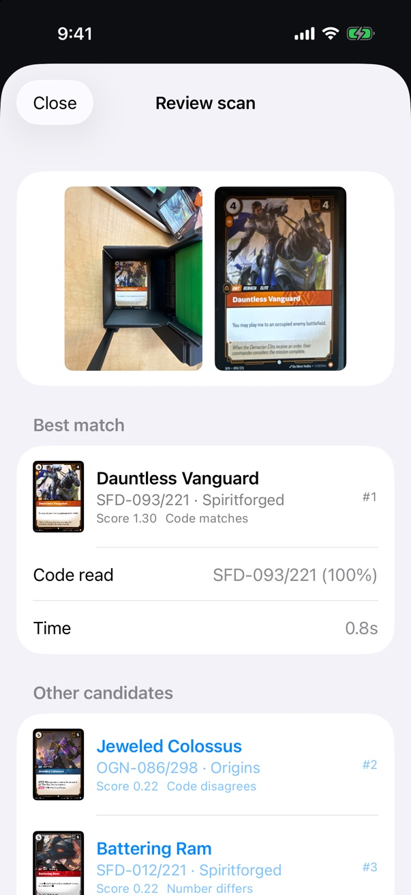
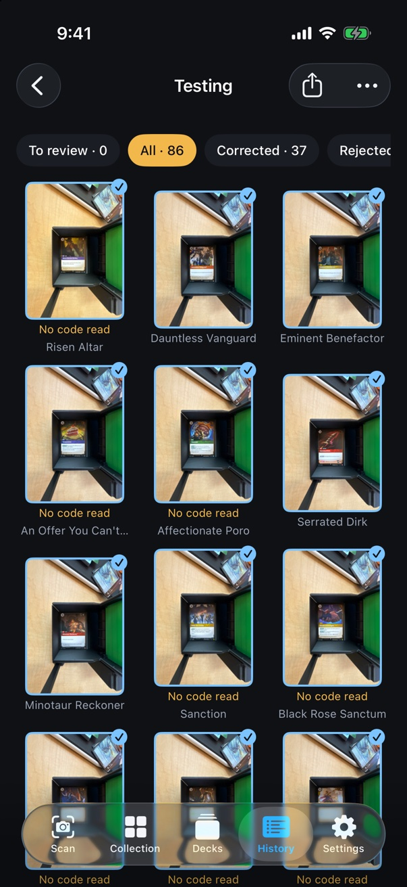
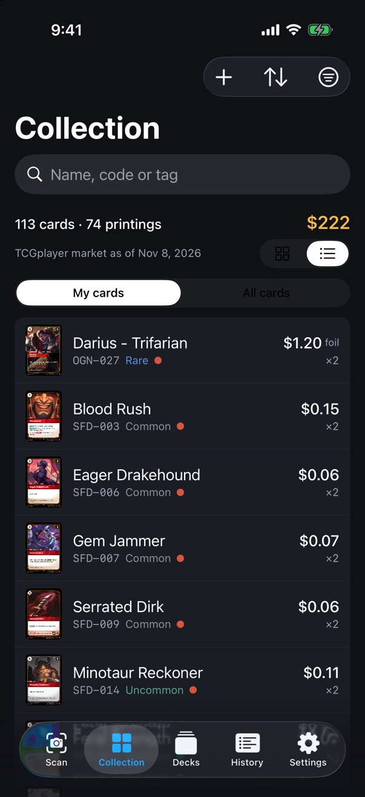

# Riftbound Scanner

Point a phone at a [Riftbound](https://playriftbound.com) card and get the exact
printing back: set, collector number, and whether it is the alternate-art or
signed version. Put a stack in a card feeder and the iPhone or Mac app scans the
whole stack, one card at a time, into a collection with market prices.

It is written in Swift on Apple's Vision and Core Image frameworks, with no
machine-learning model to train or ship.

<p align="center">
  
  &nbsp;
  
  &nbsp;
  
</p>
<p align="center"><sub>Reviewing one scan · a batch from the feeder · the resulting collection</sub></p>

## Why this exists

Riftbound is Riot Games' League of Legends trading card game. It is new, and the
tools that collectors of older games take for granted do not exist for it yet.
There is no app that scans a Riftbound card and adds it to a collection.
Cataloguing a few hundred cards by hand means typing every code off the bottom of
every card.

The hardware to do it fast already exists. The TCG Archivist CSC100 is a Bluetooth
card feeder with a phone stand above it: it pushes one card at a time into view,
and the phone photographs it. Its own app only recognises Magic: The Gathering
cards.

So this project replaces the software half:

- **A recogniser** that names a Riftbound printing from one photo.
- **A Bluetooth driver** for the CSC100, worked out by watching the vendor app's
  traffic, so the feeder can be told to advance one card at a time.
- **An iPhone app** that runs feeder, camera and recogniser together, then lets
  you confirm or fix each match.
- **A Mac app** that does the same with an iPhone as its camera, through the
  iPhone app or Continuity Camera, so you can review batches with a keyboard on
  a laptop.

Confirmed cards sync to a small self-hosted collection server, which keeps the
ledger of what you own and pulls daily prices.

## How recognition works

Every card is matched against a reference index built from the official card
gallery, about 1,400 printings.

1. **Find the card.** Vision's rectangle detector finds card-shaped outlines.
   Clutter can defeat it, so a saliency box fitted to the card's 63 : 88 shape is
   tried as well.
2. **Straighten it.** Each candidate outline is warped to a flat, upright card,
   once as found and once expanded past the gold inner frame, which the detector
   often locks onto instead of the card edge.
3. **Describe it.** Vision's image feature print and three perceptual hashes,
   two of the whole card and one of its art, are compared with every printing in
   the index. The card is scored both ways up, because a feeder takes cards
   either way round.
4. **Read the code.** OCR reads the printed set and collector number, such as
   `SFD • 093/221`, and repairs common misreads against the known codes. A
   confident reading can promote the right printing even when the art scored
   poorly.
5. **Separate twins.** Printings that share art, such as a standard card and its
   signed variant, are told apart by the code alone.

The [technical reference](docs/technical-reference.md) explains each step in detail.

## How well it works

The `riftscan synth` command renders reference cards into fake photographs with
clutter, rotation, perspective, glare, blur, noise and JPEG compression, then
measures how often the right printing comes back first.

| Difficulty | Top-1 | Top-3 |
|------------|-------|-------|
| Mild       | 98 %  | 100 % |
| Moderate   | 96 %  | 98 %  |
| Harsh      | 72 %  | 79 %  |

Measured on 3 November 2026 with 100 photos per tier on an Apple-silicon Mac. A
2-megapixel photo takes under a second.

On the feeder the card fills only about a quarter of the frame, inside a black
tray that is itself card-shaped. In the first automated run of 34 cards, cropping
to the on-screen guide and letting the printed code promote its card raised top-1
from 12 to 33 of 34. [Feeder recognition](docs/feeder-recognition.md) has the
details.

## Getting started

You need a Mac with Xcode 26 or later, [XcodeGen](https://github.com/yonaskolb/XcodeGen)
for the apps, and Python 3 for the download script. The library targets iOS 18 and
macOS 15.

**1. Download the catalog and reference images.** Card images are Riot's, so they
are fetched to a gitignored cache, about 1.2 GB, and never committed.

```bash
python3 -I Scripts/fetch-images.py
```

**2. Build the index.** This writes `cache/index.json`, about 6.4 MB, in roughly
five seconds.

```bash
swift run -c release riftscan build-index
```

**3. Identify a photo from the command line.**

```bash
swift run -c release riftscan identify path/to/photo.jpg --top 3
```

**4. Run the tests.**

```bash
swift test
```

**5. Build the iPhone app.** Replace the device ID with one from
`xcrun devicectl list devices`.

```bash
(cd App && xcodegen generate)
xcodebuild -project App/RiftboundScannerApp.xcodeproj -scheme RiftboundScannerApp \
  -destination 'id=<device udid>' -derivedDataPath App/DerivedData -allowProvisioningUpdates build
xcrun devicectl device install app --device <device udid> \
  App/DerivedData/Build/Products/Debug-iphoneos/RiftboundScannerApp.app
```

**6. Build the Mac app.**

```bash
(cd App && xcodegen generate)
xcodebuild -project App/RiftboundScannerApp.xcodeproj -scheme RiftboundScannerMac \
  -destination 'platform=macOS' -derivedDataPath App/DerivedData -allowProvisioningUpdates build
# Run it from /Applications: from under ~/Documents macOS refuses its Bonjour browse.
ditto "App/DerivedData/Build/Products/Debug/Riftbound Scanner.app" "/Applications/Riftbound Scanner.app"
open "/Applications/Riftbound Scanner.app"
```

The project file sets the author's Apple development team. Change
`DEVELOPMENT_TEAM` in `App/project.yml` to your own before building for a device.

The recogniser needs Vision's image model, which the iOS Simulator does not have.
Scanning only works on a real iPhone or on the Mac.

## The feeder

The CSC100 speaks plain ASCII over Bluetooth LE. `MOTOR:START:80` advances one
card and the feeder answers `MOTOR:COMPLETE` when it is in place, or `MOTOR:END`
when the hopper is empty. The full protocol, as observed from the vendor app, is
in [CSC100 Bluetooth notes](docs/csc100-ble.md).
`Scripts/blescan.sh` probes and drives the feeder from a Mac.

The feeder is optional. Without it, both apps take one photo per tap or per press
of the space bar.

## The collection server

The Collection and Decks tabs, price data and sync come from a separate
self-hosted server built with FastAPI and SQLite. It is not published yet.
Scanning and reviewing work without it, and scans wait on the device until a
server is reachable. The app looks for `riftbound.lan`, then `riftbound.local`,
then an address entered in Settings.

## Repository layout

| Path | What it is |
|------|------------|
| `Sources/RiftboundRecognizer` | The recogniser library. It uses only Foundation, Core Graphics, Core Image, ImageIO, Accelerate, CryptoKit and Vision, so it runs unchanged on iOS and macOS. |
| `Sources/riftscan` | The command-line tool: build the index, identify photos, generate synthetic photos, evaluate accuracy. |
| `App/` | The iPhone and Mac apps, built from one SwiftUI codebase with XcodeGen. |
| `Scripts/` | The image download, the Bluetooth probe, scan export and CI checks. |
| `Tests/` | Swift Testing suites for the library, with fixtures. |
| `docs/` | The technical reference, design records and research notes. |

## Documentation

- [Technical reference](docs/technical-reference.md) covers every component, command and design decision.
- [Collection system design](docs/adr/002-collection-system.md) is the architecture record for sync, the ledger and the learning loop.
- [CSC100 Bluetooth notes](docs/csc100-ble.md) documents the feeder protocol.
- [Feeder recognition](docs/feeder-recognition.md) analyses the first automated runs.
- [Learning evaluation](docs/learning-eval.md) and [learning policy](docs/learning-policy.md) describe how confirmed scans improve matching.

## Status

This is a personal project and a working prototype. It is used on one collection,
with one feeder, on the author's home network. Expect rough edges.

- Harsh lighting and glare are the weakest case.
- Recognition through the Mac app's Continuity Camera is still being tuned.

## License

The code is released under the [MIT License](LICENSE). The license covers this
project's own code and documentation. It grants no rights to Riot Games' card
names, text or art, including the card data in `App/Resources/CardVault.json`
and the card art visible in the screenshots.

## Card data, images and Riot Games

Riftbound Scanner was created under Riot Games' "Legal Jibber Jabber" policy using
assets owned by Riot Games. Riot Games does not endorse or sponsor this project.

Riftbound card names, text and art belong to Riot Games. Apart from the
screenshots, which show the app with the author's own scans, this repository
contains no card images. `App/Resources/CardVault.json` is a snapshot of card data
with links to Riot's gallery images, plus TCGplayer and Cardmarket prices.

The reference catalog comes from
[Dystorted888/riftbound-card-data](https://github.com/Dystorted888/riftbound-card-data),
MIT License, copyright (c) 2026 Dystorted888. The download script caches Riot's
gallery images for personal use only. Riot's
[Riftbound developer policy](https://developer.riotgames.com/policies/riftbound)
requires a published app to get its cards and images through the official Riot
API, so anything distributed beyond this personal prototype would need to switch
to it.
